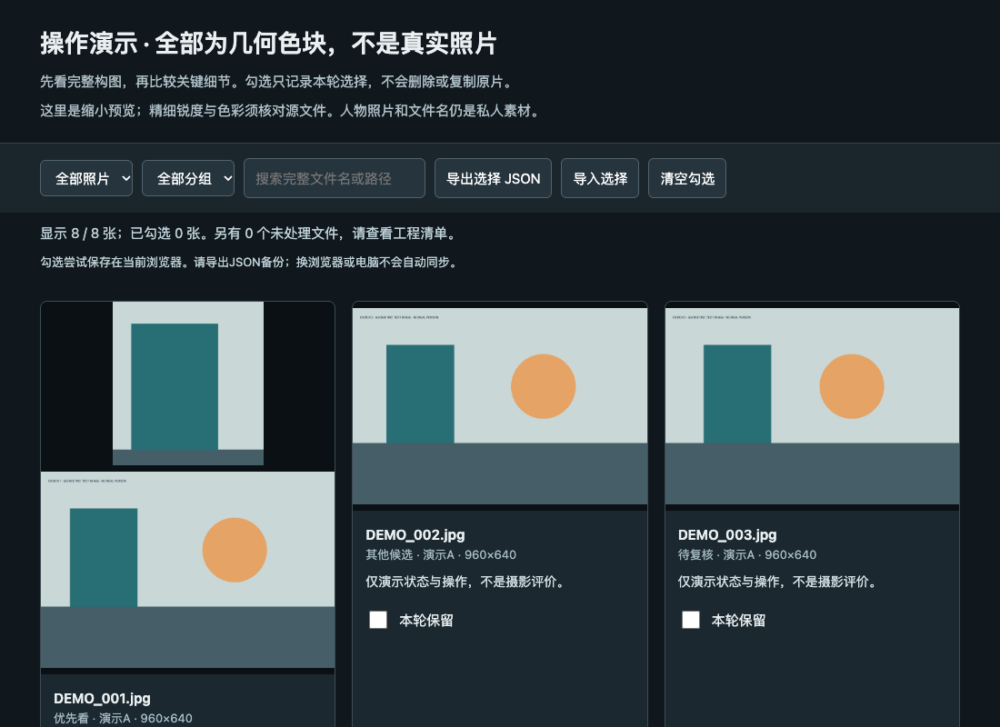

# 照片筛选 Skills

把一整场照片变成**可比较、可复选、可追溯**的候选池：全场浏览 → 防漏初筛 → 相邻帧比较 → 用户确认 → 独立副本。

适用于人像、旅行与日常记录。公开版不含原案例照片、模特资料、私有路径或账号配置。仓库名带 `mac`，表示目前在 macOS 验证过；工具采用 Python 与本地 HTML，未逐一实测其他系统。

**[下载完整 ZIP](https://github.com/guzhong1/photo-cull-mac/archive/refs/heads/main.zip)** · **[七页新手指南 PDF](2026-11-08_筛图新手上手指南.pdf)** · **[复制给 AI 的启动语](02_复制给AI.txt)**

## 第一次用，从这里开始

1. 下载 ZIP 并解压，先打开 `00_先读我.txt`。
2. 阅读 `01_新手上手.html` 或上面的 PDF。
3. 把 [`photo-cull-review/SKILL.md`](photo-cull-review/SKILL.md) 和本轮相关的 [`references`](photo-cull-review/references) 文件交给能看图的 AI，复制启动语并填写需求。
4. 先用 20–50 张照片试跑，满意后再处理整场。只有文件名、没有看到图片时，AI 不应评价画面。

不懂安装也能用：把技能当作这次对话的附件。仅当 AI 能操作你的本地文件时，它才能直接读取照片目录、生成审核页和复制文件。普通聊天上传照片会将其交给对应 AI 服务，不能称为“仅本地”。

## 包里有什么

| 内容 | 用途 |
| --- | --- |
| `photo-cull-review/` | 可安装的技能正文、判断规则、运行工具与审核页模板 |
| `02_复制给AI.txt` | 初筛、精筛、安装、保存选择和复盘的启动语 |
| `03_我的筛图需求表.md` | 用途、格式、目标数量与源文件保护要求 |
| `示例/2026-11-08_选片页操作演示.html` | 离线演示放大、勾选、筛选和名单导入导出 |
| `示例/演示素材/` | 8 张程序绘制的几何测试图，无真人 |
| `tests/smoke_test.py` | 在临时目录检验预览、名单与副本流程 |



GitHub 文件页不会直接运行 HTML。请下载并解压，在电脑浏览器打开演示文件。几何图只演示操作，不代表真实人像筛选效果。

## 保留下来的筛图方法

- **先防漏，再精简。** 不以固定比例封顶；潜在好表情、姿态和氛围进入候选，难分高下时让用户比较。
- **相近不等于重复。** 全图与关键细节一起看，比较视线、嘴角、身体、手脚、服装线条和人与环境关系。
- **技术问题和表达分开。** 闭眼、背影、不笑、轻微曝光偏差或柔焦都不能自动判坏；明显信息缺失也不承诺能修复。
- **推荐和用户决定分开。** “优先看”与“其他候选”互斥，合起来才是初筛；助理推荐不冒充最终确认。
- **保护原片。** 默认不删、不移动、不修改原片或评级，不自动修图、复制 RAW 或发布。

## 安装技能

把整个 `photo-cull-review` 文件夹安装到所用 AI 软件支持的技能目录，保留其中的相对结构。Codex 本地个人技能可放入 `~/.agents/skills/`；重新加载后显式请求使用 `$photo-cull-review`。也可以复制启动语中的“帮我安装”，交给能操作本地文件的 AI 执行并验证。

同名技能存在时先比较，不能直接覆盖。其他软件按其官方规则导入；技能不会增加软件本来没有的看图、联网或文件权限。[Codex 官方技能说明](https://learn.chatgpt.com/docs/build-skills)

## 进阶：本地工具试跑

需要 Python 3.9+ 与 Pillow。以下命令从仓库根目录运行，生成路径必须是不存在的新目录。Windows 可按实际环境把 `python3` 换成 `py -3`。

```sh
python3 -m venv .venv
```

激活虚拟环境：macOS/Linux 使用 `source .venv/bin/activate`；Windows PowerShell 使用 `.venv\Scripts\Activate.ps1`。随后安装依赖：

```sh
python -m pip install -r requirements.txt
python photo-cull-review/scripts/cull_review.py prepare --source "示例/演示素材" --output "../photo-cull-demo-review"
```

打开新工程中的 `review.html`，选两张并导出 JSON。工具此时只生成预览，**没有替你做美学判断**。输入与输出不能互为父子，也不能相同。

保存刚才明确勾选的 JPEG 副本，须把下面的名单路径换成实际下载的 JSON：

```sh
python photo-cull-review/scripts/cull_review.py copy --project "../photo-cull-demo-review" --source "示例/演示素材" --output "../photo-cull-demo-selected" --scope selected --selection "选片名单的实际路径.json"
```

复制范围是本次选择，保留相对子目录以区分同名照片，新增副本按 SHA-256 校验。网页勾选本身不操作原片。

AI 完成视觉判断后，可填写工程里的 `decisions-template.json`，再用 `review` 命令更新状态。完整命令、原片细节预览、初筛副本与格式限制见[文件与运行说明](photo-cull-review/references/files-and-tools.md)。

## 格式、隐私与能力边界

预览工具支持 JPEG、PNG、WebP、TIFF；未支持的格式及解码失败分别记录，不判坏片。复制工具仅复制 JPEG，其他格式须另行明确处理。没有看完或未能解码的照片要单列，不能声称整场筛选完成。

工具只读本地源文件，不联网；审核 HTML 会嵌入照片预览与文件名。预览不带 EXIF 不等于人物匿名，源文件副本仍保留原字节及可能存在的 GPS 等元数据。向他人分享自己的审核页前，请重新检查肖像、文件名和私人评价。

脚本无法保证零漏选，也不替代摄影师对用途和表达的判断。默认流程不包含 AI 重绘、调色、轮廓修改或社交平台发布。

## 验证与许可

本次公开发布已在 macOS 验证文件流程和本地浏览器交互。未实机验证 Windows/Linux 或所有 AI 产品的安装。可运行：

```sh
python tests/smoke_test.py
```

版本：`v1.0.0`；公开发布整理日期：2026-11-10。随包的 2026-11-08 日期表示原指南与分享版制作日期。

本仓库代码、说明与原创几何演示素材采用 [MIT License](LICENSE)。第三方照片、软件、模型和服务不随本许可授予权利。使用者后来加入的个人照片不属于仓库提供的开源素材。
